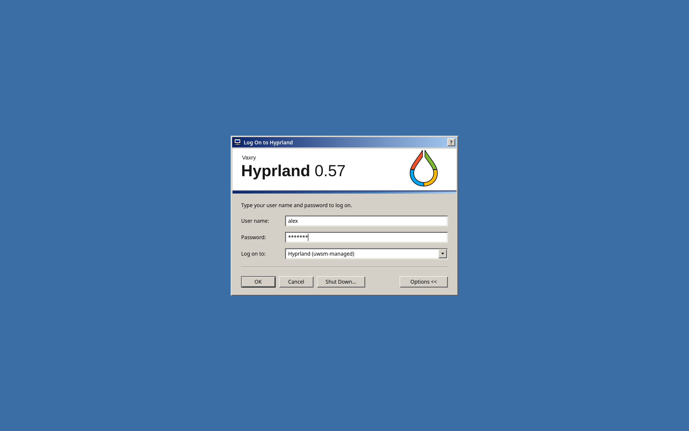

# regreet-win2k



A Windows 2000-style ReGreet login screen.

## Install

You need greetd already set up to start ReGreet through `/etc/greetd/hyprland.lua`, plus `git` and Rust (`cargo`).

```sh
./build.sh           # as yourself, not root/sudo
sudo ./install.sh
```

Log out or reboot to see it. If it ever fails to start (for example after a GTK update), you get the normal ReGreet login screen instead. To fix it, run both commands above again.

## Uninstall

```sh
sudo ./install.sh --uninstall
./build.sh --clean   # optional: delete the downloaded source and build files
```

This brings back the stock ReGreet login screen.
